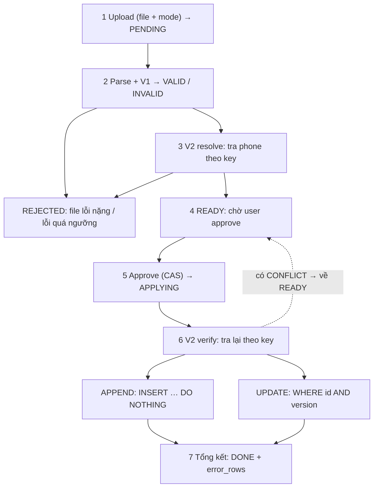
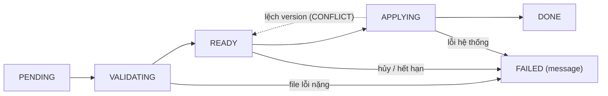

# Thiết kế import phone: APPEND và UPDATE

*Luồng xử lý, state machine, validate V1/V2 và xử lý concurrency*

## 1. Tổng quan

User upload file CSV gồm `key`, `quantity` để thêm hoặc sửa bảng `phone`. Mode chọn lúc upload và áp cho cả file: **APPEND** (chỉ thêm key mới) hoặc **UPDATE** (chỉ sửa key đã có). Rule nghiệp vụ duy nhất của import: **key không được trùng**.

| Bảng | Cột chính | Vai trò |
|---|---|---|
| `phone_import` | `id`, `status`, `mode`, `version`, `created_by`, `message`, `error_rows` | Header, 1 dòng cho mỗi lần upload. Giữ state machine của cả lần import. |
| `phone_draft` | `import_id`, `row_number`, `key`, `quantity`, `status`, `error_code`, `matched_id`, `matched_version` | Bảng nháp, 1 dòng cho mỗi dòng file. Giữ state từng dòng. |
| `phone` | `id`, `key` (UNIQUE), `quantity`, `version`, `created_at` | Bảng thật. Chỉ bị ghi ở bước Apply. |

## 2. Luồng tổng



*Hình 1. Luồng import từ upload đến hoàn tất. Trong bản PDF, màu vàng: cần user xử lý; màu xanh: ghi vào phone.*

| # | Việc làm | `phone_import` | `phone_draft` |
|---|---|---|---|
| 1 | Upload file và chọn mode. Có import khác chưa kết thúc thì trả 409. | tạo mới PENDING | chưa có |
| 2 | Parse CSV vào draft và chạy V1. Sai header hoặc lỗi quá ngưỡng thì dừng. | VALIDATING, hoặc FAILED | PARSED → VALID / INVALID |
| 3 | V2 resolve: tra phone theo key, gán kết quả vào draft. | VALIDATING | VALID giữ nguyên, hoặc INVALID kèm `error_code`; UPDATE lưu `matched_id`, `matched_version` |
| 4 | Tổng hợp lỗi, user xem preview. Cần sửa file thì hủy và upload lại. | READY (`version + 1`) | |
| 5 | Approve kèm version, CAS READY → APPLYING. | APPLYING | |
| 6 | V2 verify: tra lại. Có CONFLICT thì không ghi gì, quay về bước 4. | APPLYING → READY, `version + 1` | dòng lệch: CONFLICT |
| 7 | Apply theo chunk (không gọi V2). | APPLYING | APPLIED, FAILED hoặc SKIPPED |
| 8 | Tổng kết. | DONE kèm `error_rows` | chờ dọn theo TTL |

## 3. Hai mức validate

### V1: soft validate, chỉ nhìn file

- Size file, header, kiểu dữ liệu, trùng key trong file. Chạy một lần lúc parse.
- `key` phải được normalize (trim, lowercase...) đúng theo cách `phone.key` đang lưu, nếu không so sánh sẽ lệch.
- Dòng đạt là VALID, dòng lỗi là INVALID.

### V2: heavy validate, tra bảng phone (chỉ rule key)

Đọc draft theo chunk 500 đến 1000 dòng, mỗi chunk một query, không query từng dòng:

```sql
SELECT id, key, version FROM phone WHERE key IN (:keys_of_chunk);
```

**Resolve** chạy một lần sau V1 và ghi kết quả vào draft:

| Kết quả tra key | Mode APPEND | Mode UPDATE |
|---|---|---|
| Chưa có trong phone | OK, sẽ INSERT | INVALID (`KEY_NOT_FOUND`) |
| Đã có trong phone | INVALID (`KEY_EXISTS`) | OK, lưu `matched_id` và `matched_version` |

**Verify** chạy lại mỗi lần user approve, để bắt thay đổi của phone từ lúc resolve:

| Mode | Verify thấy gì | Kết quả |
|---|---|---|
| APPEND | key giờ đã có trong phone | CONFLICT (`KEY_EXISTS`) |
| UPDATE | key không còn trong phone | CONFLICT (đã bị xóa) |
| UPDATE | version khác `matched_version` | CONFLICT (có người sửa giữa chừng) |

Lúc Apply không gọi V2. Nếu READY để quá lâu (ví dụ hơn 24 giờ) thì buộc resolve lại trước khi cho approve.

## 4. State machine



*Hình 2. State machine của `phone_import`.*

| State | Ý nghĩa |
|---|---|
| PENDING | Vừa upload, chờ worker nhận. |
| VALIDATING | Đang parse, chạy V1 và V2 resolve. |
| READY | Validate xong, chờ user approve. Không ai ghi gì. |
| APPLYING | Đang verify rồi ghi vào phone. |
| DONE | Xong. Số dòng lỗi nằm ở `error_rows`. |
| FAILED | Dữ liệu bị từ chối, hệ thống lỗi, user hủy hoặc hết hạn. Lý do ở cột `message`. |

### State của từng dòng trong `phone_draft`

| State | Ý nghĩa và chuyển tiếp |
|---|---|
| PARSED | Vừa ghi từ file. Sau V1/V2 thành VALID hoặc INVALID. |
| VALID | Đủ điều kiện apply. Apply xong thành APPLIED hoặc FAILED. Verify lệch thì thành CONFLICT. |
| INVALID | Kết thúc, không apply, nằm trong error report. |
| CONFLICT | Verify thấy phone đã đổi. User chọn bỏ qua (SKIPPED) hoặc ghi đè (về VALID). |
| APPLIED / FAILED / SKIPPED | Kết quả cuối của dòng. |

## 5. Apply

### Mode APPEND

```sql
INSERT INTO phone (key, quantity, version, created_at)
VALUES ('A', ...), ('B', ...), ('C', ...), ('D', ...)
ON CONFLICT (key) DO NOTHING
RETURNING key;
```

- Ví dụ: phone đã có sẵn key B. RETURNING trả về A, C, D. B bị DB bỏ qua và không có trong kết quả.
- Dòng có key trong RETURNING thì APPLIED. Dòng không có thì FAILED với `KEY_EXISTS`.
- Cả chunk vẫn chạy trong một câu lệnh, một dòng trùng không làm hỏng các dòng khác.
- Không dùng DO UPDATE (upsert), vì sẽ âm thầm ghi đè dữ liệu có sẵn, trái với ý nghĩa mode APPEND.
- Điều kiện: V1 đã loại trùng key trong file, và phone với phone_draft cùng một DB để ghi phone và cập nhật draft chung một transaction.

### Mode UPDATE

```sql
UPDATE phone
SET quantity = :quantity, version = version + 1
WHERE id = :matched_id AND version = :matched_version;
```

- Trúng 1 dòng: APPLIED.
- Trúng 0 dòng: có người sửa chen vào sau verify. Dòng đó FAILED, các dòng khác vẫn chạy.
- Verify lệch thì user chọn cho từng dòng CONFLICT: bỏ qua (SKIPPED), hoặc ghi đè (gán `matched_version` bằng version hiện tại của phone, dòng về VALID), hoặc hủy cả import. Sau đó approve lại.

## 6. Concurrency

Trọng tài là DB, không dùng lock trong memory, nên chạy đúng với nhiều pod. Chỉ cần ba chỗ:

| Chỗ | Rủi ro | Cách chặn |
|---|---|---|
| Upload | Hai import chạy cùng lúc | Partial unique index, import thứ hai nhận 409 |
| Approve | Double-click, hai admin cùng bấm, bấm trên preview cũ | CAS kèm version của import |
| Ghi vào phone | Có người tạo hoặc sửa key giữa verify và apply | UNIQUE (`key`) cho APPEND, WHERE `version = ...` cho UPDATE |

```sql
CREATE UNIQUE INDEX uq_one_active_import ON phone_import ((1))
  WHERE status NOT IN ('DONE', 'FAILED');

UPDATE phone_import SET status = 'APPLYING', version = version + 1
WHERE id = :id AND status = 'READY' AND version = :clientVersion;
-- 0 dòng thì trả 409
```

Khi chạy nhiều pod:

- File upload lưu ở chỗ dùng chung (S3/MinIO hoặc volume chung), không để trên disk local của pod.
- Mọi chuyển state đi qua một hàm dùng `UPDATE ... WHERE status = :from`. Trả 0 dòng nghĩa là pod khác đã xử lý.
- Job nền viết theo kiểu CAS để nhiều pod cùng chạy cũng vô hại. Dùng `now()` của DB để tính timeout.
- Với Spring Batch: `importId` là UUID ngẫu nhiên mỗi lần launch nên JobRepository không chặn trùng. Việc chặn do `phone_import` đảm nhiệm.

## 7. API

| API | Mục đích |
|---|---|
| `POST /imports (file, mode)` | Tạo import, trả 202 kèm `importId`. 409 nếu có import chưa kết thúc. |
| `GET /imports/{id}` | Trạng thái, version và số liệu tổng quan. Client poll. |
| `GET /imports/{id}/rows?status=&page=` | Preview, danh sách lỗi và CONFLICT. Phân trang, tải được error report. |
| `POST /imports/{id}/rows/{rowNo}/resolve (SKIP \| FORCE)` | User chọn cách xử lý cho dòng CONFLICT. |
| `POST /imports/{id}/approve (version)` | Chuyển READY → APPLYING. 409 nếu sai state hoặc version cũ. |
| `POST /imports/{id}/cancel` | Hủy khi chưa vào APPLYING. |

Trả `importId` (UUID) ra ngoài, không trả `jobExecutionId` của Spring Batch. Trạng thái trả về là state của `phone_import`, không phải BatchStatus.

## 8. Job nền

- Quét import kẹt ở VALIDATING hoặc APPLYING quá lâu (theo `updated_at` hoặc heartbeat), đưa về state trước đó hoặc FAILED.
- READY quá hạn thì chuyển FAILED để nhả mutex.
- Dọn `phone_draft` và file upload sau N ngày.

## 9. Ranh giới với nghiệp vụ phone

- State của import nằm ở `phone_import` và `phone_draft`. State nghiệp vụ của phone do phone tự quản. Không đặt cột kiểu `import_status` vào phone.
- Dòng được tạo ra phải có state khởi tạo đúng nghiệp vụ, ghi rõ ở bước Apply, không để mặc định ngầm.
- Muốn truy vết thì thêm cột `created_by_import_id` (cho phép NULL) hoặc bảng audit. Không dùng nó để điều khiển nghiệp vụ.
- Sau Apply phát sự kiện cho các phần khác của inventory (reindex, cache...), tốt nhất qua outbox. Từ đó import không còn liên quan.
- Apply bằng SQL trực tiếp bỏ qua domain service của phone. Chấp nhận được vì rule duy nhất là key. Nếu sau này phone có thêm rule thì đưa vào V1/V2 hoặc cho Apply đi qua domain service.

## 10. Phân tách code approval hiện tại

### Quy tắc khi phát triển

- Khi feature chưa ready, không tạo mới hoặc sửa test, trừ khi người dùng yêu cầu rõ ràng. Có thể kiểm tra compile để phát hiện lỗi code.
- Không tạo thêm file khi không cần thiết. Ưu tiên dùng class/file có sẵn phù hợp với trách nhiệm; chỉ tách file mới khi thực sự cần giữ ranh giới nghiệp vụ và infrastructure.
- Dùng bean khi cần Spring quản lý scope, lifecycle, proxy hoặc chia sẻ dependency. Object chỉ phục vụ nội bộ một job, không cần các cơ chế đó, ưu tiên factory method thường; không bắt buộc mọi thành phần infrastructure đều là bean. Việc khởi tạo và nối dependency nằm trong cấu hình, không lẫn vào nghiệp vụ.

Áp dụng cho cấu hình approval:

| Object | Cách tạo | Lý do |
|---|---|---|
| Listener, decider | Private factory method | Job giữ và gọi trực tiếp, dependency truyền qua tham số; không cần Spring scope/proxy/lifecycle. |
| Processor | Method reference | Chuyển đổi dữ liệu bằng hàm không giữ state. |
| Reader, writer | Bean `@StepScope` | Đọc job parameters khi step chạy; reader có cursor riêng theo step execution. |
| Executor chạy job/chunk | Bean | Spring quản lý lifecycle, gọi `close()` khi hủy bean; không tự tạo executor rồi bỏ trách nhiệm đóng. Việc chờ task hoàn tất còn phụ thuộc cấu hình executor. |
| Job launcher | Bean | Được inject vào launcher facade và cần callback khởi tạo `afterPropertiesSet()`. |
| Job, step | Bean | Giữ cách nối dependency qua Spring hiện tại và các callback khởi tạo của Batch; không bỏ bean chỉ vì một nơi sử dụng. |
| TransactionalOperator | Bean | Writer và persistence adapter dùng chung cấu hình transaction. |
| Datasource | Bean | Binding cấu hình, nhận diện Batch datasource và đóng tài nguyên khi shutdown. |

Số nơi sử dụng không phải tiêu chí duy nhất để quyết định bean. Factory method thường không cần `proxyBeanMethods = false` mới hoạt động: method không có `@Bean` không bị intercept như bean method. Object thường vẫn có thể được truyền mock dependency khi kiểm tra; không phải bean chỉ có nghĩa là không inject/override nó qua Spring container được.

- `ApproveImportJob`: gọi Batch launcher, kiểm tra trạng thái import/draft, chuẩn bị phone, áp dụng APPEND/UPDATE/RESTOCK và chuyển trạng thái qua repository port. Không tách thêm approval service.
- `ApproveImportJob.ApprovalConfiguration`: lớp cấu hình riêng ngay trong file `ApproveImportJob.java`. Reader/writer là bean có `@StepScope`; executor, step và job được Spring quản lý. Listener và decider được tạo bằng private factory method; processor dùng method reference trực tiếp. Job tạo một instance decider và dùng lại instance đó cho các nhánh flow. Reader phân trang trên toàn bộ draft, không lọc VALID khi các worker đang chuyển dòng sang APPLIED.
- Processor dùng hàm nghiệp vụ không giữ state; writer, decider và listener nhận trực tiếp repository port cần dùng. Các bean không inject ngược `ApproveImportJob`; launcher nhận `Job` bình thường, không cần `@Lazy`. Các hàm nghiệp vụ trong cùng file nhận dependency qua tham số, không nhận `JobExecution`, transaction manager hoặc executor.
- `BatchInfrastructureConfiguration`: cung cấp bean `inventoryTransactions` dùng chung cho writer và draft persistence adapter. Writer bọc thao tác ghi phone và cập nhật draft của một chunk trong cùng transaction R2DBC; Batch metadata dùng transaction manager riêng.

Validation gate chạy sau validate: tất cả draft hợp lệ thì sang apply; còn dòng không hợp lệ thì kết thúc bằng `.end("BLOCKED")`: BatchStatus là COMPLETED, ExitStatus là BLOCKED. Listener chỉ dịch BatchStatus/ExitStatus sang `ApprovalOutcome`; hàm nghiệp vụ `statusAfter` ánh xạ BLOCKED → READY, DONE → DONE, FAILED → FAILED. Không truyền kết quả validation qua ExecutionContext nữa. Các thao tác reactive chỉ `.block()` ở điểm gọi đồng bộ của launcher và các callback Batch.

- Vòng đời import đặt cạnh nhau: `claim` giành quyền approve, `release` trả READY khi launch lỗi, `complete` kết thúc theo outcome. Các bước trả/kết thúc dùng chung CAS trên version đã claim.
- `Settings` là record trong cùng file, đăng ký bằng `@EnableConfigurationProperties`, bind prefix `app.phone-import.approval` và validate bằng `@Validated`, `@Min(1)`. Mặc định workers = 5, chunk-size = 500; reader và step dùng chung chunk-size. `launch-workers` vẫn thuộc cấu hình launcher riêng.
- `PagedDraftReader` là class nội bộ cuối file; factory chỉ tạo và bọc `SynchronizedItemReader`. Cursor vẫn thuộc instance theo StepScope.
- Apply gồm phần đọc dữ liệu (`loadChange`), hàm thuần chọn thay đổi (`selectChange`) và ghi (`executeChange`). `selectChange` nhận mode, dữ liệu phone và version; không gọi repository, không sửa object snapshot đầu vào. Kết quả `PhoneChange` chứa phone cần lưu và expectedVersion. Không tạo thêm strategy/service/file.

### Transaction và concurrency đã áp dụng

- Trạng thái implementation hiện tại là `APPROVING`. Khi approve, đọc import rồi CAS bằng `id + status = READY + version` để chuyển sang APPROVING và tăng version. Chỉ request thắng CAS được launch job; request thua nhận CONFLICT.
- Version sau khi giành quyền approve được truyền vào job parameter `approvalVersion`. Listener và xử lý launch lỗi chỉ chuyển trạng thái khi import vẫn APPROVING và đúng version này. Callback cũ không được ghi đè trạng thái của lần approve mới. Nếu khôi phục trạng thái cũng lỗi, vẫn giữ lỗi launch gốc và đính kèm lỗi khôi phục.
- UPDATE/RESTOCK yêu cầu `matchedVersion` khác null và khớp version hiện tại của phone. Lệnh save dùng chính `matchedVersion`; `@Version` trên persistence entity chặn thay đổi chen vào giữa lần đọc và lần ghi.
- Writer dùng `Mono.defer` và bean `inventoryTransactions` để bao toàn bộ thao tác của chunk trong transaction R2DBC. `drafts.saveAll` tham gia transaction đang có qua propagation REQUIRED. JDBC transaction manager của Batch phục vụ metadata riêng, không thay transaction dữ liệu.
- Lỗi ghi, draft không còn VALID hoặc version phone thay đổi làm rollback toàn bộ chunk và job chuyển FAILED. Những chunk đã commit vẫn được giữ. APPEND dùng ràng buộc UNIQUE của key; trùng key lúc ghi cũng làm chunk thất bại. Implementation này chưa có cơ chế bỏ qua riêng dòng xung đột như thiết kế ở mục 5.
- Tên trạng thái flow và key job parameter được gom thành hằng số trong `ApproveImportJob`.

Phạm vi hiện tại: CAS dùng version vừa đọc từ DB; API approve chưa nhận version của preview từ client. Validate khi approve vẫn resolve lại `matchedVersion`, nên kiểm tra lúc apply bảo vệ thay đổi sau lần validate đó; chưa triển khai cơ chế CONFLICT/SKIP/FORCE cho thay đổi kể từ preview. Các mục thiết kế phía trên mô tả cả những phần chưa triển khai này.

Giới hạn hoàn tất trạng thái: Spring Batch bắt và log exception từ `afterJob`, không tự retry hay chuyển job thành FAILED. CAS trả false nghĩa là callback không còn quyền cập nhật; không được bỏ điều kiện CAS để ghi đè. Nếu DB lỗi khi hoàn tất, import có thể còn APPROVING dù Batch đã kết thúc. Retry/reconcile bền vững vẫn cần triển khai riêng; lần refactor sáu mục này chưa giải quyết cơ chế phục hồi đó.

Kiểm tra trong lần sửa này: compile Java và rà soát diff; không tạo, sửa hoặc chạy test khi feature chưa ready. Chưa xác minh transaction/concurrency bằng chạy tích hợp trên DB.
