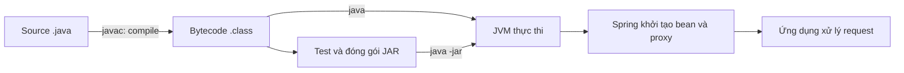
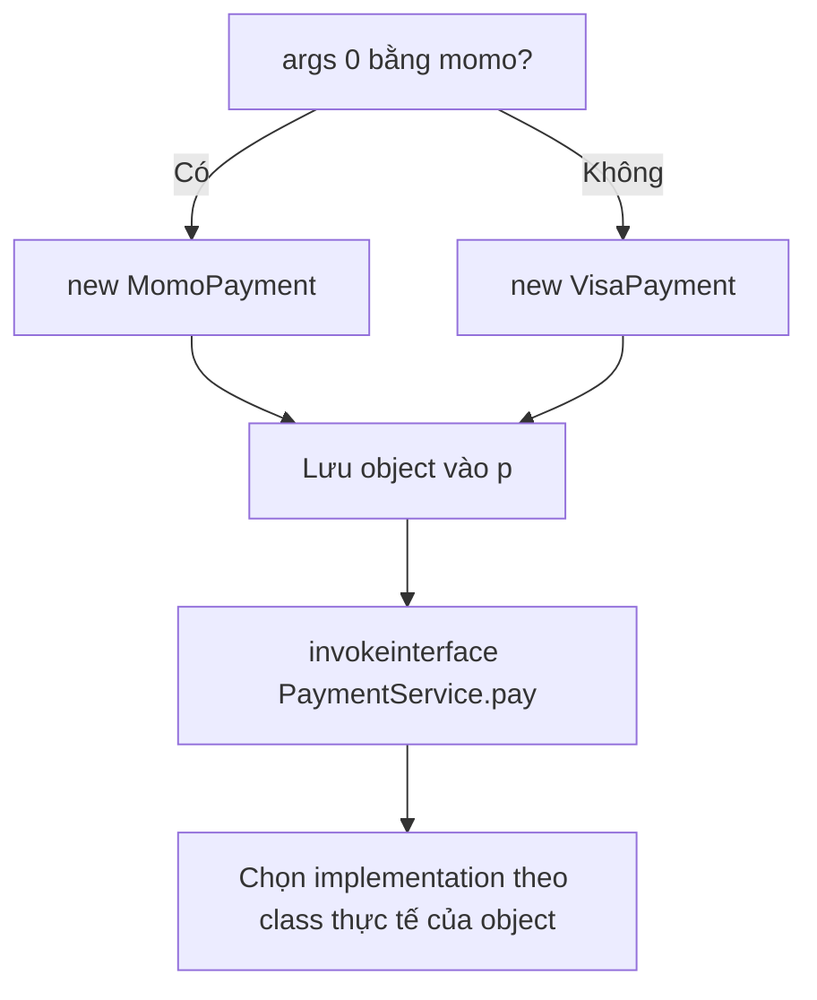
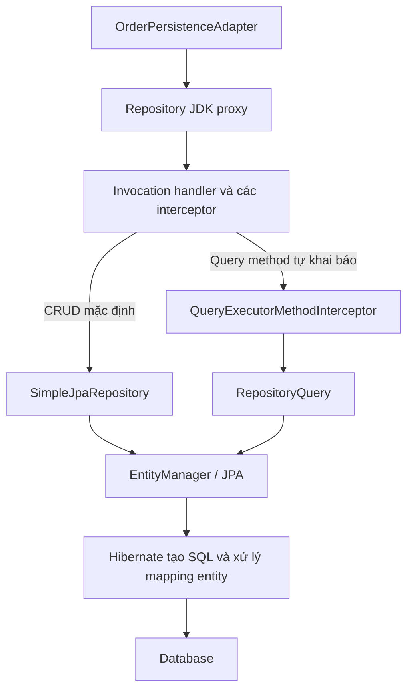
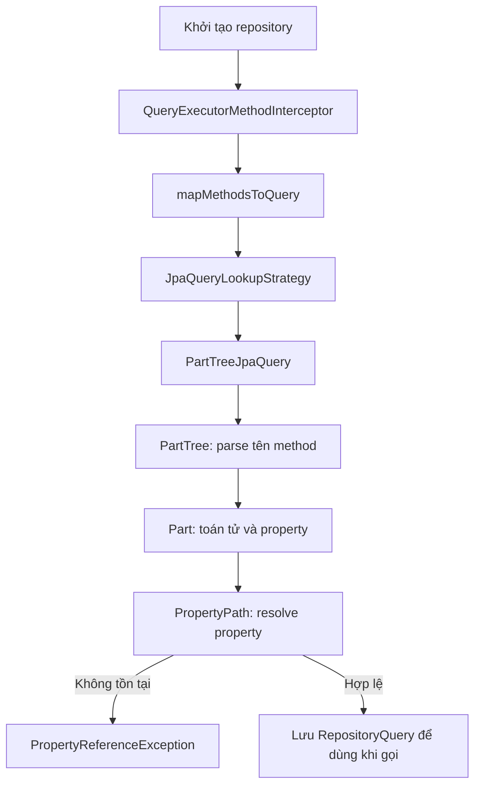

# Java bytecode, interface dispatch và Spring Data proxy

Ghi chú theo ví dụ thực tế trong project: Java 21, Spring Boot 3.3.5 và Spring Data 3.3.5.

## 1. Build, compile và runtime

**Compile** là biên dịch `.java` thành bytecode `.class`. **Build** là quy trình rộng hơn, thường gồm compile, chạy test và đóng gói JAR. **Runtime** là lúc JVM thực thi chương trình.



Spring tạo repository proxy khi khởi tạo repository: đây là runtime, dù ứng dụng chưa nhận request. Test được chạy trong quá trình build cũng có runtime riêng của lần chạy test đó.

| Lệnh | Công việc |
|---|---|
| `javac` | Compile source thành `.class` |
| `javap -c` | Hiển thị các lệnh bytecode; không chạy `main()` |
| `java` | Chạy chương trình |
| `gradlew build` | Chạy quy trình build do Gradle cấu hình |

## 2. Ví dụ chọn implementation lúc chạy

Source thật: [Demo.java](../src/main/java/com/miniecommerce/order/example/Demo.java).

```java
package com.miniecommerce.order.example;

interface PaymentService {
    void pay(int amount);
}

class MomoPayment implements PaymentService {
    @Override
    public void pay(int amount) {
        System.out.println("Momo: " + amount);
    }
}

class VisaPayment implements PaymentService {
    @Override
    public void pay(int amount) {
        System.out.println("Visa: " + amount);
    }
}

public class Demo {
    public static void main(String[] args) {
        PaymentService p = args[0].equals("momo")
                ? new MomoPayment()
                : new VisaPayment();
        p.pay(100);
    }
}
```

Từ thư mục gốc `mini_app`, compile và xem bytecode:

```shell
javac -d order_service/build/bytecode-demo order_service/src/main/java/com/miniecommerce/order/example/Demo.java
javap -c -cp order_service/build/bytecode-demo com.miniecommerce.order.example.Demo
```

- `-d`: thư mục gốc để ghi các file `.class`, bên dưới có cây thư mục theo package.
- `-cp`: classpath, tức nơi bắt đầu tìm class.
- `-c`: yêu cầu `javap` hiển thị bytecode.
- Tham số cuối của `javap` là tên class đầy đủ, gồm cả package.

Chạy hai nhánh:

```shell
java -cp order_service/build/bytecode-demo com.miniecommerce.order.example.Demo momo
java -cp order_service/build/bytecode-demo com.miniecommerce.order.example.Demo visa
```

Kết quả đã kiểm tra:

```text
Momo: 100
Visa: 100
```

Ví dụ yêu cầu ít nhất một đối số. Không truyền đối số sẽ lỗi tại `args[0]`; mọi giá trị khác `momo` đều đi vào nhánh Visa.

## 3. Đọc output của javap

Bytecode thực tế của `main()`; tên package trong comment được rút gọn:

```text
 0: aload_0
 1: iconst_0
 2: aaload
 3: ldc           #7       // String momo
 5: invokevirtual #9       // String.equals(...)
 8: ifeq          21
11: new           #15      // class MomoPayment
14: dup
15: invokespecial #17      // MomoPayment.<init>()
18: goto          28
21: new           #18      // class VisaPayment
24: dup
25: invokespecial #20      // VisaPayment.<init>()
28: astore_1
29: aload_1
30: bipush        100
32: invokeinterface #21, 2 // PaymentService.pay:(I)V
37: return
```

| Vị trí | Ý nghĩa |
|---|---|
| `0–2` | Lấy mảng `args` từ local slot 0, lấy phần tử chỉ số 0 |
| `3–5` | Đưa chuỗi `momo` lên operand stack và gọi `equals` |
| `8` | Nếu kết quả bằng 0 (`false`), nhảy tới vị trí 21 |
| `11–15` | Cấp phát `MomoPayment`, nhân đôi tham chiếu, gọi constructor |
| `18` | Bỏ qua nhánh Visa, nhảy tới 28 |
| `21–25` | Cấp phát `VisaPayment` và gọi constructor |
| `28` | Lưu tham chiếu object vào local slot 1, chính là biến `p` |
| `29–30` | Đưa object `p` và số `100` lên operand stack |
| `32` | Gọi `pay(int)` qua interface `PaymentService` |
| `37` | Kết thúc method |



`dup` giữ lại một bản tham chiếu trên stack vì lời gọi constructor tiêu thụ bản tham chiếu dùng làm receiver. Bản còn lại được lưu vào `p`.

Trong `PaymentService.pay:(I)V`:

- `(I)` nghĩa là nhận một tham số `int`.
- `V` nghĩa là trả về `void`.
- `#21` là chỉ số trong constant pool của class, không phải địa chỉ method trong RAM.
- `2` là số slot đối số của lệnh `invokeinterface` trong ví dụ: receiver và một `int`. Với `long`/`double`, mỗi tham số chiếm hai slot.
- Các số đầu dòng là offset byte trong code của method, không phải số dòng Java.

Constructor `Demo()` do compiler tự thêm có bytecode gọi `Object.<init>()`, tương đương `super()`.

## 4. Compile time biết gì, runtime biết gì?

```java
PaymentService p = new MomoPayment();
p.pay(100);
```

Ở ví dụ trên, người đọc có thể suy ra implementation sẽ chạy vì object được tạo rõ ràng. Compiler cũng biết class cần cấp phát cho biểu thức `new`. Tuy nhiên, lời gọi qua biến kiểu `PaymentService` vẫn được `javac` biểu diễn bằng `invokeinterface`.

Với ví dụ dùng `args[0]`, build tạo bytecode cho cả hai nhánh. Đến runtime mới có giá trị đối số để quyết định nhánh nào chạy.

| Thời điểm | Thông tin |
|---|---|
| Compile time | Kiểu khai báo của `p`, chữ ký `PaymentService.pay(int)`, tính hợp lệ của lời gọi |
| Runtime | Object thực tế mà `p` đang trỏ tới và implementation được chọn |

## 5. JVM tra bảng nào để gọi implementation?

Trong HotSpot, cơ chế dispatch qua interface có **itable** (interface method table), thuộc metadata của class. Các object cùng class dùng chung metadata này.

Sơ đồ khái niệm, không phải layout bộ nhớ chính xác:

```text
p ──► object MomoPayment ──► metadata class MomoPayment
                              └─ interface PaymentService
                                  └─ slot pay(int) ──► MomoPayment.pay(int)

      object VisaPayment ──► metadata class VisaPayment
                              └─ interface PaymentService
                                  └─ slot pay(int) ──► VisaPayment.pay(int)
```

JVM dùng thông tin method đã resolve và class của receiver để tìm implementation; không cần so chuỗi `pay` mỗi lần gọi. Không nên nhầm constant pool index `#21` trong bytecode với itable index nội bộ.

Source HotSpot đang có trên máy:

```text
D:/APP/githay/jdk-master/src/hotspot/cpu/x86/templateTable_x86.cpp
```

Tìm `TemplateTable::invokeinterface` và `lookup_interface_method`. Đây là đường xử lý interpreter cho x86. JIT có thể tối ưu bằng cache, gọi trực tiếp hoặc inline, nên không phải lần gọi nào cũng tra itable theo sơ đồ trên.

## 6. Spring Data tạo implementation cho repository thế nào?

Repository của project:

```java
public interface OrderJpaRepository
        extends JpaRepository<OrderEntity, String> {
}
```

Spring Data tạo repository proxy khi khởi tạo repository. Trong lần chạy đã kiểm tra, đây là JDK dynamic proxy. Proxy triển khai interface và chuyển lời gọi sang invocation handler cùng chuỗi interceptor của Spring.



`save()` và `findById()` kế thừa có implementation CRUD trong `SimpleJpaRepository`. Method như `findByStatus(...)` do người dùng khai báo được xử lý qua cơ chế query của Spring Data.

Proxy không chứa toàn bộ logic parse tên method hoặc code SQL. Repository proxy cũng khác proxy lazy-loading của Hibernate: hai cơ chế có nhiệm vụ khác nhau.

## 7. Lưu file proxy để xem

VM option đã thêm cho run configuration `OrderServiceApplication` trong IntelliJ:

```text
-Duser.timezone=UTC -Djdk.proxy.ProxyGenerator.saveGeneratedFiles=true
```

Chạy lại app để JVM ghi các JDK proxy được tạo thành `.class`, dưới working directory. Trong lần kiểm tra trước, proxy của `OrderJpaRepository` nằm ở:

```text
D:/APP/commit_apps/mini_app/jdk/proxy2/$Proxy159.class
```

Số proxy và thư mục có thể thay đổi giữa các lần chạy. Mở file bằng IntelliJ và xem interface mà class `implements` để xác định đúng repository.

`OrderPersistenceAdapter.class` dưới `build/classes` là class compile từ source của ứng dụng. File `$Proxy...class` được JVM sinh động trong runtime. Bytecode decompile trong IntelliJ là bản dựng lại từ `.class`, không phải source `.java` nguyên gốc.

## 8. Spring Data parse findByStatus ở đâu?

Dependency `spring-boot-starter-data-jpa` trong [build.gradle](../build.gradle) kéo vào Spring Data JPA. Máy đã có source JAR phiên bản 3.3.5 trong Gradle cache.

Trong IntelliJ, dùng **Ctrl + N**, bật tìm cả thư viện / **All Places**, rồi mở các class sau:

| Class | Dòng trong source 3.3.5 đã kiểm tra | Công việc |
|---|---:|---|
| `RepositoryFactorySupport` | 357 | Thêm `QueryExecutorMethodInterceptor` vào proxy |
| `QueryExecutorMethodInterceptor` | 96 | `mapMethodsToQuery(...)`: ánh xạ method sang query |
| `JpaQueryLookupStrategy` | 124 | Nhánh tạo query từ tên method gọi `new PartTreeJpaQuery(...)` |
| `PartTreeJpaQuery` | 101 | `new PartTree(method.getName(), domainClass)` |
| `PartTree` | 85 | Constructor bắt đầu parse tên method |
| `Part` | 81 | Tách property từ phần điều kiện và gọi `PropertyPath.from(...)` |
| `PropertyPath` | 94 | Ném `PropertyReferenceException` nếu property không tồn tại |

Luồng rút gọn cho derived query, tức query suy ra từ tên method:



Ví dụ minh họa, giả sử entity có `status` và `total`:

```text
findByStatusAndTotalGreaterThan
       │          │
       │          └─ total > tham số thứ hai
       └─ status = tham số thứ nhất
```

Parser nhận diện tiền tố, các phần `And`/`Or`, toán tử như `GreaterThan`, rồi resolve property trên domain type. Nó hỗ trợ cả đường dẫn property lồng nhau, nên thực tế phức tạp hơn chỉ viết thường chữ đầu.

Đây là code Java của Spring Data, không phải tính năng JVM hiểu từ khóa `findBy`. Query từ `@Query` hoặc named query có đường xử lý khác, không nhất thiết đi qua `PartTree`.

Repository hiện tại đang rỗng, chỉ kế thừa CRUD. Muốn quan sát parser này bằng debugger cần một derived query method tự khai báo. Có thể đặt breakpoint ở `PartTreeJpaQuery:101` và `PropertyPath:94`.

## 9. Sai tên field lỗi lúc nào?

Nếu entity có `status` nhưng khai báo derived query `findByStatuss(...)`, Spring Data không resolve được property và báo lỗi khi khởi tạo query của repository.

Với chế độ khởi tạo repository mặc định, việc này diễn ra khi app khởi động, khiến startup thất bại. Với cấu hình lazy/deferred, thời điểm khởi tạo và xuất hiện lỗi có thể muộn hơn. Vì vậy phát biểu chính xác là **lỗi khi repository/query được khởi tạo**, không tuyệt đối là mọi lỗi query đều được phát hiện ngay lúc app start.

| Việc | Thành phần chính | Thời điểm |
|---|---|---|
| Sinh bytecode class ứng dụng | `javac` | Compile |
| Tạo class JDK proxy khi cần | JDK proxy, được Spring yêu cầu | Runtime, lúc tạo proxy |
| Parse derived query, resolve property | Spring Data | Lúc khởi tạo query repository |
| Gắn tham số, thực thi query, xử lý kết quả | Spring Data và JPA provider | Khi gọi method |
| Chuyển JPA query thành SQL, map entity | Hibernate trong project này | Khi chuẩn bị/thực thi truy vấn |
| Áp dụng transaction và dịch exception | Các interceptor/advisor Spring phù hợp | Khi lời gọi đi qua proxy, tùy cấu hình |

Cây parse được giữ trong query object để tái sử dụng. Điều này không có nghĩa mỗi lần gọi không tốn xử lý: vẫn cần bind tham số, có thể dựng lại Criteria query tùy trường hợp, chạy DB và xử lý kết quả. Transaction cũng không tự động giống nhau cho mọi query method; còn phụ thuộc metadata và ranh giới transaction ở service.

## 10. CMD, PowerShell và WSL

JDK Windows và JDK trong Ubuntu WSL là hai môi trường riêng. Có `javac` trong PATH của Windows không đảm bảo WSL có lệnh đó; có `javac` trên PATH cũng cần kiểm tra `javap` có được tìm thấy hay không.

Nếu CMD không nhận `javap`, dùng đường dẫn đã có trên máy:

```cmd
"C:\Program Files\Java\jdk-21\bin\javap.exe" -c -cp order_service/build/bytecode-demo com.miniecommerce.order.example.Demo
```

Trong PowerShell, thêm toán tử gọi `&` trước đường dẫn được đặt trong dấu nháy:

```powershell
& "C:\Program Files\Java\jdk-21\bin\javap.exe" -c -cp order_service/build/bytecode-demo com.miniecommerce.order.example.Demo
```

Trong WSL, từ `/mnt/d/APP/commit_apps/mini_app`, có thể gọi executable Windows qua interop:

```bash
"/mnt/c/Program Files/Java/jdk-21/bin/javap.exe" -c -cp order_service/build/bytecode-demo com.miniecommerce.order.example.Demo
```

Các sơ đồ Mermaid trong tài liệu cần trình xem Markdown hỗ trợ Mermaid; các bảng và sơ đồ text vẫn đọc được trực tiếp trong editor.
